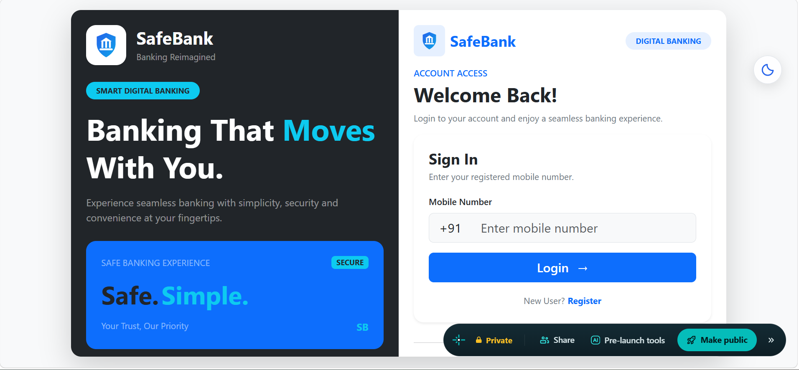
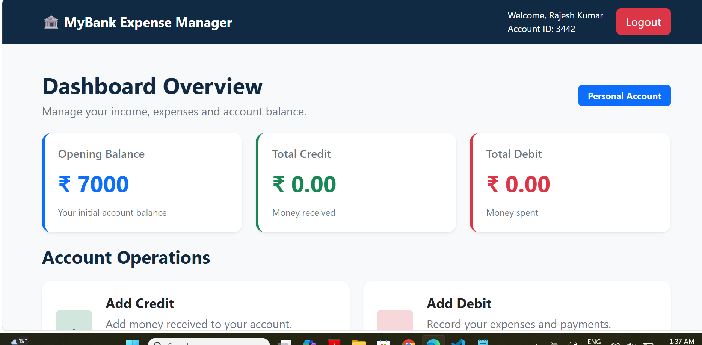
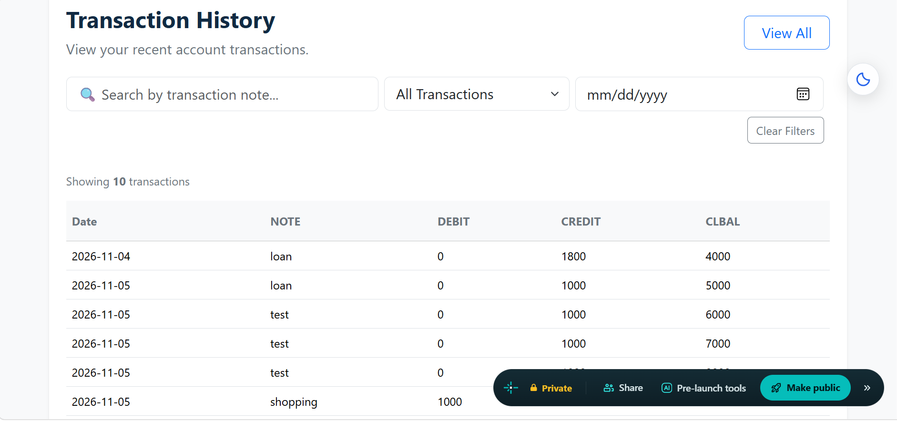
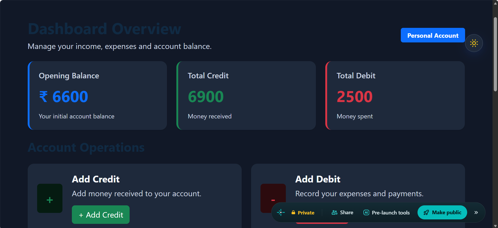

# SafeBank – Expense Manager

A professional and responsive expense management web application that helps users manage their income, expenses, and account balance through a simple dashboard.

## 🌐 Live Demo

[Open SafeBank](https://joyful-shortbread-967490.netlify.app/)

## ✨ Features

- User Registration
- Mobile Number Login
- Personal Dashboard
- Opening Balance Management
- Add Credit Transactions
- Add Debit Transactions
- Transaction History
- Transaction Search and Filtering
- Dark and Light Mode
- Responsive Design
- Logout Functionality

## 🛠️ Technologies Used

- HTML5
- CSS3
- JavaScript
- Bootstrap 5.3.3
- Axios
- REST API Integration

## 📸 Project Screenshots

### Login & Registration

### Dashboard – Light Mode

### Transaction History

### Dashboard – Dark Mode

## 🚀 Deployment

The project is deployed using Netlify and connected to GitHub for source code management.

## 📁 Project Structure

- index.html – Login and Registration
- dash.html – Main Dashboard
- theme.css – Custom Styling
- theme.js – Dark/Light Mode
- README.md – Project Documentation

## 🔗 API Integration

SafeBank uses Axios to communicate with external APIs for:

- User Registration
- User Login
- Opening Balance Retrieval
- Credit and Debit Transactions
- Transaction History

## 👨‍💻 Developer

**Raghav Sidana**

- GitHub: [raghavsidana83](https://github.com/raghavsidana83)

---

⭐ If you like this project, consider giving it a star!
